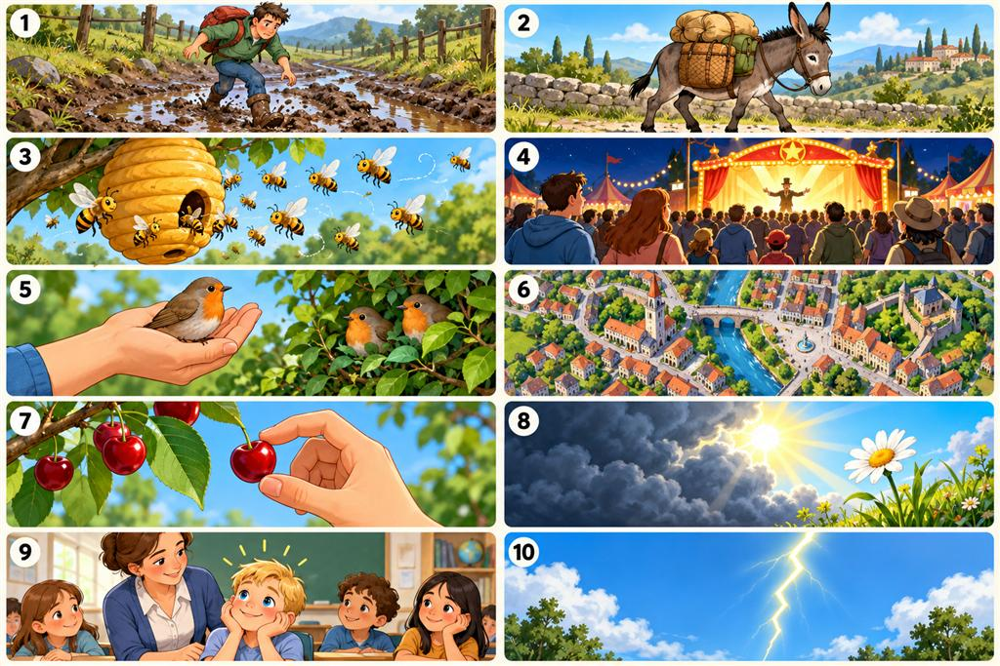

# Ten English Idioms — Study Pack Index

A quick route through the ten entries. Each entry has its own file with the phrase, meaning, Hindi gloss, cautious origin note, example, memory hook, and a checked crop of its matching numbered panel.

## Quick index

| Panel | English phrase | Entry | Illustration |
|---:|---|---|---|
| 1 | A bad patch | [Open entry](idioms/01-a-bad-patch.md) | [Panel 1](illustrations/01-a-bad-patch.jpg) |
| 2 | A beast of burden | [Open entry](idioms/02-a-beast-of-burden.md) | [Panel 2](illustrations/02-a-beast-of-burden.jpg) |
| 3 | A beehive / a hive of activity | [Open entry](idioms/03-a-hive-of-activity.md) | [Panel 3](illustrations/03-a-hive-of-activity.jpg) |
| 4 | A big draw | [Open entry](idioms/04-a-big-draw.md) | [Panel 4](illustrations/04-a-big-draw.jpg) |
| 5 | A bird in the hand is worth two in the bush | [Open entry](idioms/05-a-bird-in-the-hand.md) | [Panel 5](illustrations/05-a-bird-in-the-hand.jpg) |
| 6 | A bird's-eye view | [Open entry](idioms/06-a-birds-eye-view.md) | [Panel 6](illustrations/06-a-birds-eye-view.jpg) |
| 7 | A bite at the cherry | [Open entry](idioms/07-a-bite-at-the-cherry.md) | [Panel 7](illustrations/07-a-bite-at-the-cherry.jpg) |
| 8 | A blessing in disguise (also: a boon in disguise) | [Open entry](idioms/08-a-blessing-in-disguise.md) | [Panel 8](illustrations/08-a-blessing-in-disguise.jpg) |
| 9 | A blue-eyed boy | [Open entry](idioms/09-a-blue-eyed-boy.md) | [Panel 9](illustrations/09-a-blue-eyed-boy.jpg) |
| 10 | A bolt from the blue | [Open entry](idioms/10-a-bolt-from-the-blue.md) | [Panel 10](illustrations/10-a-bolt-from-the-blue.jpg) |

## Original illustrated sheet

The original numbered sheet is kept intact: [Open the full JPG](idioms-illustrated-study-sheet.jpg). The ten separate images linked above are crops from its corresponding numbered panels; each crop was checked against the original sheet.

## Source files and citation notes

- [Original README](README.md) — source pack description and use notes.
- [Original idioms guide](idioms-guide.md) — source wording for meanings, Hindi glosses, examples, memory hooks, origin notes, and references. It remains unchanged.
- [Original illustrated sheet](idioms-illustrated-study-sheet.jpg) — retained unchanged; individual panel crops are additional files.

All origin wording here follows the source guide; uncertain or unverified origins remain explicitly uncertain. The source guide mentions a full-resolution PNG, but the supplied source files in this folder include only the JPG; that JPG is the preserved original used for the crops.

### References listed in the original guide

- Collins Dictionary, “a bad patch / a rough patch”: <https://www.collinsdictionary.com/us/dictionary/english/a-bad-patch-a-rough-patch>
- Etymonline, “burden”: <https://www.etymonline.com/word/burden>
- Dictionary.com, “beast of burden”: <https://www.dictionary.com/browse/beast-of-burden>
- Etymonline, “beehive”: <https://www.etymonline.com/word/beehive>
- Phrases.org.uk, “A bird in the hand is worth two in the bush”: <https://www.phrases.org.uk/meanings/a-bird-in-the-hand.html>
- Etymonline, “bird”: <https://www.etymonline.com/word/bird>
- Oxford Learner's Dictionaries, “a bite at the cherry”: <https://www.oxfordlearnersdictionaries.com/definition/english/cherry>
- Phrase Finder, “A bolt from the blue”: <https://www.phrases.org.uk/meanings/70700.html>
- Idiom Origins, “Blue-eyed boy”: <https://idiomorigins.org/origin/blue-eyed-boy>
- Word Histories, “a blessing in disguise”: <https://wordhistories.net/2024/03/10/blessing-in-disguise/>

The source guide notes that sources may record different dates and that a documented metaphor or early citation does not establish who coined an expression.
